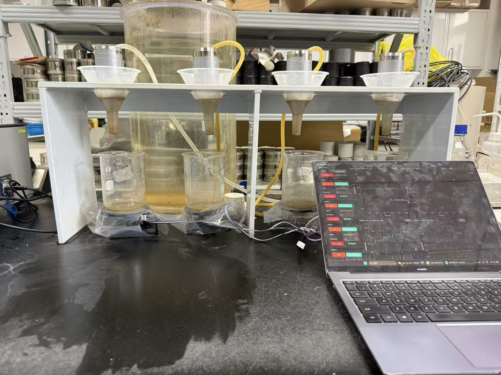
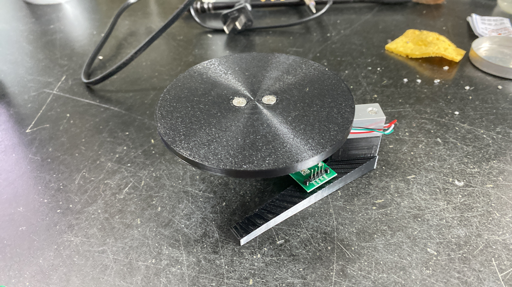
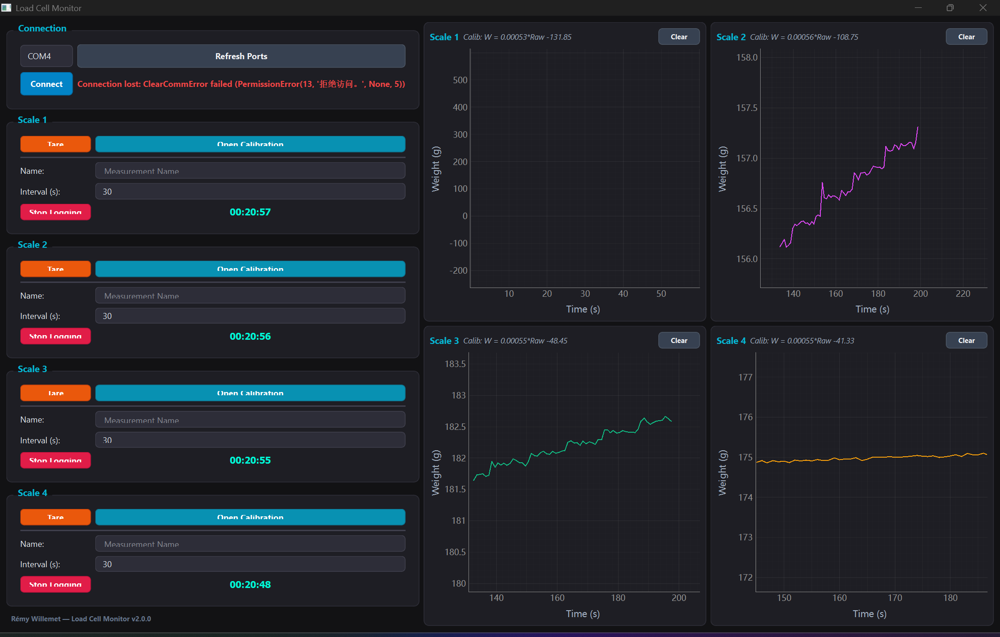

# Beaker Load Cell Monitoring System
[](https://doi.org/10.5281/zenodo.20725690)

**Load Cell Monitoring Scale System** is an automated 4-channel weighing data logger designed to monitor countinuous weight measurements. 

The system was conceptualized to improve the accuracy and efficiency of soil hydraulic conductivity measurements (such as constant-head saturated hydraulic conductivity, $K_{sat}$, of soil cores) while allowing a greater number of replicates to be performed within the same timeframe. Instead of manually recording beaker masses or reading volumetric cylinders with a stopwatch, four straight-beam load cells (TAL220) mounted in 3D-printed cantilever supports continuously measure the mass of water collected in up to four 500 mL beakers. The readings are digitized by 24-bit HX711 amplifiers and streamed via USB to a desktop application for automated real-time logging.

The companion GUI supports multi-point calibration per channel, tracks sensor calibration drift over time, and logs cumulative outflow curves directly to CSV.

| Laboratory setup | 3D-printed load cell support |
| :---: | :---: |
|  |  |

## How it works

- **4-channel 24-bit precision**: Four 1 kg straight-beam load cells (TAL220) paired with dedicated HX711 ADC amplifiers monitor up to four 500 mL beakers (~500 g water + ~150–200 g beaker tare).
- **1 Hz live data streaming**: The ESP32 continuously polls all four scales and streams raw 24-bit readings and calibrated weights over USB serial (`115200` baud) in a lightweight JSON format.
- **Multi-point calibration & drift tracking**: Calibration factors and tare offsets are handled per sensor, stored in `data/calibration.json`, and can be re-calibrated at any time with known reference weights.
- **Independent logging channels**: Each scale can be started, stopped, named, and logged at independent recording intervals (e.g. 5, 10, or 30 seconds).

## Hardware & wiring

| Scale Channel | HX711 Pin | ESP32 Pin (GPIO) | Function |
| :--- | :--- | :--- | :--- |
| **Power** | `VCC` / `VDD` & `GND` | `3V3` & `GND` | Common 3.3 V power and ground |
| **Scale 1** | `DT` / `SCK` | `GPIO 16` / `GPIO 17` | Channel 1 Data & Clock |
| **Scale 2** | `DT` / `SCK` | `GPIO 18` / `GPIO 19` | Channel 2 Data & Clock |
| **Scale 3** | `DT` / `SCK` | `GPIO 22` / `GPIO 23` | Channel 3 Data & Clock |
| **Scale 4** | `DT` / `SCK` | `GPIO 32` / `GPIO 33` | Channel 4 Data & Clock |

Load cells are wired to each HX711 using standard 4-wire Wheatstone bridge colors: `Red` (`E+`), `Black` (`E-`), `White` (`A-`), `Green` (`A+`).

CAD models (`.f3d`), technical drawings ([`Supports_Drawing.png`](3D_model/Supports_Drawing.png)), and ready-to-print STL files for the cantilever plates are in [`3D_model/`](3D_model/).

## Flashing the firmware

The firmware in [`MCU_scr/`](MCU_scr/) is built with [PlatformIO](https://platformio.org/):

```powershell
cd MCU_scr
pio run -t upload
```

The ESP32 samples all four scales, responds to JSON commands (`TARE`, `CALIBRATE`, `SET_CALIBRATION`), and streams live JSON data over USB serial at `115200` baud.

## Desktop app & laboratory workflow

Install Python dependencies and launch the PyQt6 interface:

```powershell
python -m pip install -r Software/requirements.txt
python Software/main.py
```

*(On Windows, `install.bat` and `Run_Load_Cell.bat` can also be used directly).*

1. **Connect**: Select the serial COM port (`115200` baud) and click **Connect**.
2. **Tare & Calibrate**: Clear the scale platform and click **Tare**. Place a known calibration weight (e.g. 20 g, 50 g, 100 g), enter its value in grams, and click **Calibrate**. The calibration dialog allows inspecting calibration curves and tracking load cell drift over time.
3. **Set logging parameters**: Assign a sample/replicate name and logging interval (seconds) for each active scale.
4. **Log outflow**: Click **Start Logging** on active channels. Cumulative mass readings are plotted in real time and saved directly to CSV.

<p align="center">
  
</p>

## CSV output

Data is written to `data/{YYYYMMDD_HHMMSS}_{name}_Scale{N}.csv`. Each row logs:

`timestamp`, `datetime`, `elapsed_s`, `raw`, `weight`

Cumulative outflow mass $m(t)$ translates directly to outflow volume $V(t) = m(t) / \rho_w$. When combined with the soil core cross-sectional area, sample height, and hydraulic head, saturated hydraulic conductivity ($K_{sat}$) can be calculated from the steady-state outflow slope via Darcy's law.

## Repository layout

- [`3D_model/`](3D_model/) — Fusion 360 models, technical drawings, and 3D-printable cantilever support plates
- [`MCU_scr/`](MCU_scr/) — ESP32 firmware (PlatformIO project)
- [`Software/`](Software/) — Python PyQt6 desktop acquisition and calibration interface
- [`Pictures/`](Pictures/) — Laboratory setup photographs and GUI previews
- [`data/`](data/) — Output folder for CSV logs and persistent `calibration.json`

## Authors

- **Rémy Willemet** – *ILVO / Ghent University* – [remy.willemet@ilvo.vlaanderen.be](mailto:remy.willemet@ilvo.vlaanderen.be)

## License

This project utilizes separate licensing for hardware designs and software:

<<<<<<< HEAD
- **Hardware Designs** (`3D_model/`): Licensed under the **[CERN Open Hardware Licence Version 2 - Permissive (CERN-OHL-P v2)](LICENSE)**.
  - Copyright © 2026 **Rémy Willemet**.
- **Software & Firmware** (`MCU_scr/`, `Software/`, root scripts): Dedicated to the **Public Domain** under **[Creative Commons CC0 1.0 Universal](LICENSE)** (or The Unlicense) with no copyright reserved.
=======
## Contact
**Rémy Willemet**
Research Institute for Agriculture, Fisheries and Food (ILVO)  
Email: [remy.willemet@ilvo.vlaanderen.be](mailto:remy.willemet@ilvo.vlaanderen.be)
>>>>>>> a67f26da75e6e8085ce09e82e3754a0288211e71
